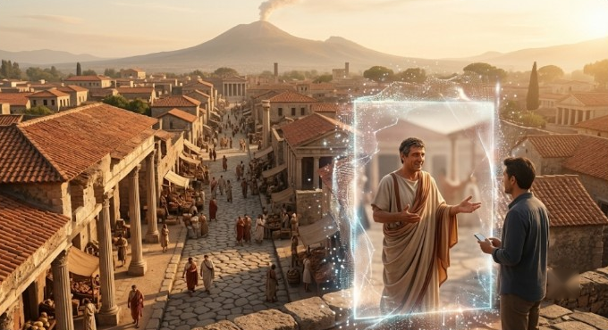
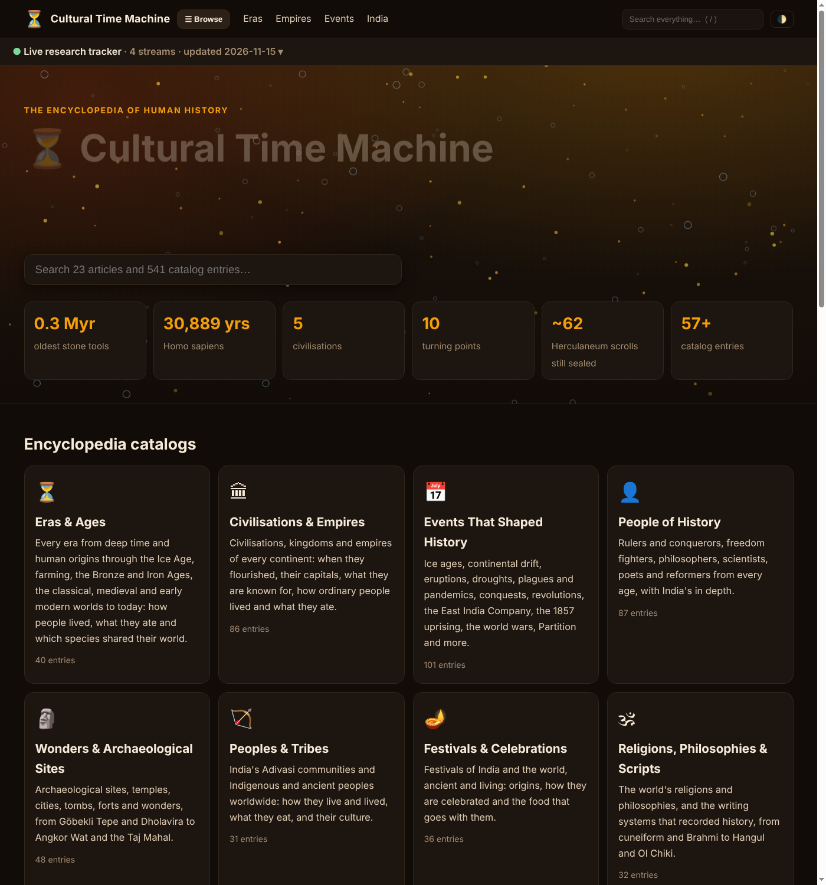
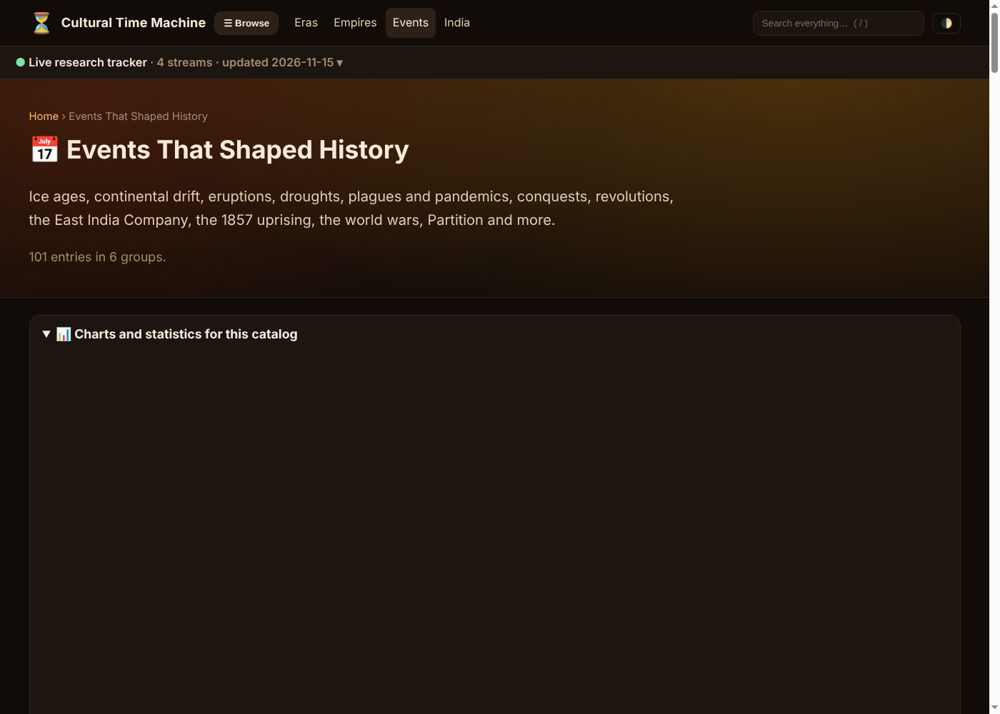
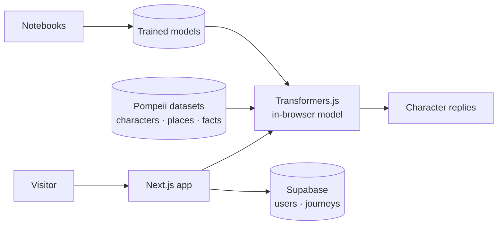

<div align="center">



# 🕰️ AI Cultural Time Machine

### Chat with historical figures and explore reconstructed eras — AI running locally in your browser

     

[](LICENSE)    

[](https://codespaces.new/shiroonigami23-ui/ai-cultural-timemachine?quickstart=1) [](https://github.com/shiroonigami23-ui/ai-cultural-timemachine/archive/refs/heads/main.zip)

[**Overview**](#-overview) · [**Features**](#-features) · [**Architecture**](#-architecture) · [**Getting Started**](#-getting-started) · [**Roadmap**](#-roadmap)

</div>

---

## 📖 Overview

**AI Cultural Time Machine** lets you step into history. Choose an era — starting with **Pompeii** and extending to Ancient Rome and Victorian London — then **chat with AI-powered historical characters**, explore **reconstructed scenes** and listen to **period soundscapes**. Models run **locally in the browser** with Hugging Face Transformers.js, so conversations work without API calls. Curated data (characters, locations, daily life, Latin phrases, historical facts) grounds every answer.

### ✨ Highlights

- **Local, private AI** — Transformers.js in the browser
- **Curated historical datasets** for Pompeii
- **Training notebooks** for text and image models
- **Supabase** schema for accounts and saved journeys

## 📜 Cultural Time Machine Encyclopedia (new)

A full **history encyclopedia** now ships with the app in [`history/`](history/). It has **900+ catalog entries** and **48 in-depth articles** spanning every era from Pangaea and human origins to today.

| Catalog | Entries | What's inside |
|---|---|---|
| 🌳 Branching timeline | 674 dated items | Civilisations and dynasties of 10 regions side by side, plus a full timeline for each region |
| 🦴 Human species | 27 | From *Sahelanthropus* and Lucy to *Homo erectus*, Neanderthals, Denisovans and us: brain size, height, tools, firsts |
| ⏳ Eras & Ages | 40 | Deep time to the Information Age: how people lived, what they ate, the species of the time |
| 🏛 Civilisations & Empires | 86 | Government, daily life, food, construction, technology, how each rose and how it fell, and its legacy |
| 👑 Dynasties & Rulers | 98 | Founders, capitals, notable rulers, how each gained and lost power |
| 📅 Events | 247 | Human evolution, ice ages, eruptions, plagues, conquests, the East India Company, 1857, both world wars, Partition; each tagged with its region |
| 👤 People | 87 | Rulers, freedom fighters, thinkers and scientists |
| 🗿 Sites & Wonders | 48 | Göbekli Tepe, Dholavira, the Pyramids, Angkor, the Taj Mahal |
| 🗣 Languages | 52 | Language families, ancient and modern languages, scripts and descendants |
| 🏹 Peoples & Tribes | 31 | Hunter-gatherers, Adivasi and Indigenous peoples, Neanderthals |
| 🪔 Festivals | 36 | Origins, how they are celebrated, festive food |
| 🕉 Religions, Philosophies & Scripts | 32 | Cuneiform to Ol Chiki |
| ⚙ Inventions | 81 | Fire, cooking, clothing, iron, zero, steel, printing, AI |
| 🦣 Species of Past Ages | 23 | Mammoths, *Smilodon*, the dodo, the aurochs |
| 📄 Research papers | 14 | Ancient DNA, the Indus, climate and collapse |

There are **48 long articles**, including: from the trees to two feet; fire and cooking; the human family tree; hunter-gatherer life; the evolution of language; how iron changed everything; how empires and monarchy rose and fell; region-by-region histories of Africa, the Middle East, Europe, East Asia, Southeast Asia and Oceania, the Americas and the steppe; and India from Bhimbetka to today. Entries link to related entries within the encyclopedia: people to their dynasties, events to the civilisations and people involved, sites to the people who built them, and languages to their descendants.

Every entry page loads a **live photo**, the **full Wikipedia article** in collapsible sections and **OpenAlex research papers**. The site also has animated statistics, a live archaeology tracker (the Herculaneum scrolls, Keeladi), a timeline, a glossary and a full bibliography.

<p align="center"> </p>

**How to open it:**
- **In the app:** the home page links to `/history/index.html`. `npm run dev` and `npm run build` copy the encyclopedia into `public/history` automatically (`scripts/copy-history.js`).
- **On GitHub Pages:** live at https://shiroonigami23-ui.github.io/ai-cultural-timemachine/. GitHub Pages serves the repo root, where `index.html` sends visitors straight to `history/index.html`, and `.nojekyll` makes sure the files are served exactly as built. The workflow `.github/workflows/history-pages.yml` rebuilds the encyclopedia and checks every link on each push.
- **Rebuild after editing:** run `npm run history:build`, or `cd history && python3 scripts/build_site.py`. You need Python 3 and `pip install -r history/scripts/requirements.txt`.
- **Reuse the data in the app:** load the JSON catalogs in `history/site_src/data/*.json`.
- **Missing images:** [`history/prompts.md`](history/prompts.md) lists a Nano Banana prompt and a save path for every entry. Only generate the ones the site's *Photo status* page reports as missing, then rebuild.

## 🧩 Features

| Feature | What it does |
|---|---|
| **Historical chat** | Talk to characters defined in `data/pompeii/characters.json` |
| **Eras & locations** | Explore places from `locations.json` |
| **Daily-life facts** | Grounding from `daily_life.json`, `historical_facts.json`, `latin_phrases.json` |
| **Visual reconstruction** | AI-generated period scenes |
| **Soundscapes** | Ambient audio per location |
| **Notebooks** | Data prep, text and image training |
| **Offline-capable** | Progressive enhancement for all devices |

## 🛠 Tech Stack

| Layer | Technology |
|---|---|
| Front-end | Next.js 15, TypeScript, Tailwind |
| AI | Hugging Face Transformers (in-browser) |
| Data | JSON datasets, Supabase |
| Deploy | Vercel |

## 🏗 Architecture




➡️ Full design notes, data flow and design decisions: **[docs/ARCHITECTURE.md](docs/ARCHITECTURE.md)**

## 📁 Project Structure

```text
ai-cultural-timemachine/
├── src/{app,components,lib}/
├── data/pompeii/        # characters, locations, daily life, facts, Latin, texts, audio
├── notebooks/           # 00 data prep, 01 text, 02 image
├── supabase/schema.sql
└── next.config.js · vercel.json
```

## 🚀 Getting Started

### 1. Get the code

Pick whichever method suits you:

| Method | Command |
|---|---|
| **HTTPS** | `git clone https://github.com/shiroonigami23-ui/ai-cultural-timemachine.git` |
| **SSH** | `git clone git@github.com:shiroonigami23-ui/ai-cultural-timemachine.git` |
| **GitHub CLI** | `gh repo clone shiroonigami23-ui/ai-cultural-timemachine` |
| **ZIP** | [Download](https://github.com/shiroonigami23-ui/ai-cultural-timemachine/archive/refs/heads/main.zip) and extract |
| **Codespaces** | [Open in browser](https://codespaces.new/shiroonigami23-ui/ai-cultural-timemachine?quickstart=1) — zero local setup, dev container preconfigured |

> 🔑 **Using SSH for the first time?** Generate a key with `ssh-keygen -t ed25519 -C "you@example.com"`, add the `.pub` contents at **GitHub → Settings → SSH and GPG keys**, then test with `ssh -T git@github.com`.

### 2. Install & set up

```bash
cd ai-cultural-timemachine
npm install
cp .env.example .env.local
```

### 3. Run

```bash
npm run dev     # http://localhost:3000
```
Helper scripts: `install.sh`, `setup-deployment.sh`, `supabase.sh`. See [DEVELOPMENT.md](DEVELOPMENT.md).

## 🗺 Roadmap

**v0.1 — Pompeii (in progress)**

- [x] Next.js scaffold, datasets, Supabase schema
- [x] Training notebooks
- [ ] Character chat UI with local model

**v0.2**

- [ ] Image reconstructions per location
- [ ] Ambient audio engine
- [ ] Guided tours with quizzes

**v1.0**

- [ ] Ancient Rome and Victorian London eras
- [ ] Multilingual (Hindi/English/Latin)
- [ ] Teacher mode for classrooms

➡️ Detailed plan, milestones and long-term vision: **[docs/ROADMAP.md](docs/ROADMAP.md)**

## 🤝 Contributing

Contributions, issues and feature requests are welcome!

1. Fork the repository
2. Create a feature branch: `git checkout -b feature/amazing-feature`
3. Commit your changes: `git commit -m "feat: add amazing feature"`
4. Push the branch: `git push origin feature/amazing-feature`
5. Open a Pull Request against `main`

Check the [issues page](https://github.com/shiroonigami23-ui/ai-cultural-timemachine/issues) and the [roadmap](docs/ROADMAP.md) for ideas on where to help.

## 📜 Changelog

See [CHANGELOG.md](CHANGELOG.md) for the release history.

## 📄 License

Distributed under the **MIT** license. See [LICENSE](LICENSE) for details.

## 👤 Author

**Aryan Singh Chandel** (Shiro)

[](https://github.com/shiroonigami23-ui)

<div align="center">

⭐ **If you find this project useful, consider giving it a star!** ⭐

</div>
