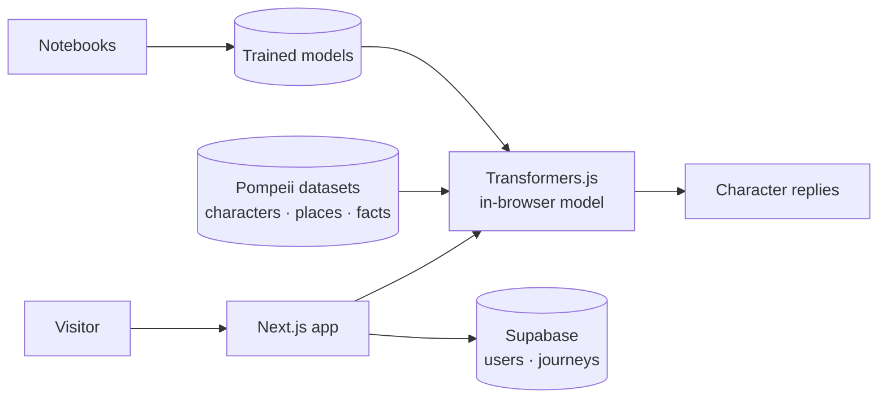

# 🏗 Architecture — AI Cultural Time Machine

> Part of [ai-cultural-timemachine](https://github.com/shiroonigami23-ui/ai-cultural-timemachine). Back to the [README](../README.md).

## 1. System Overview

The Next.js front-end loads curated JSON for the selected era and runs a small language model in the browser to role-play characters, constrained by the dataset.

## 2. Components

| Component | Location | Responsibility |
|---|---|---|
| **App** | `src/app` | Pages and routes |
| **Components** | `src/components` | Chat, scene, audio UI |
| **Lib** | `src/lib` | Model loading, data access |
| **Data** | `data/pompeii` | Grounding content |

## 3. Data / Control Flow

1. Pick an era and character.
2. The model receives persona + facts as context.
3. Replies stream into the chat.

## 4. Key Design Decisions

| Decision | Rationale |
|---|---|
| In-browser inference | Privacy and zero API cost |

## 5. Known Limitations

- Only the Pompeii dataset exists so far

---
*Last updated: 2026-11-14*
